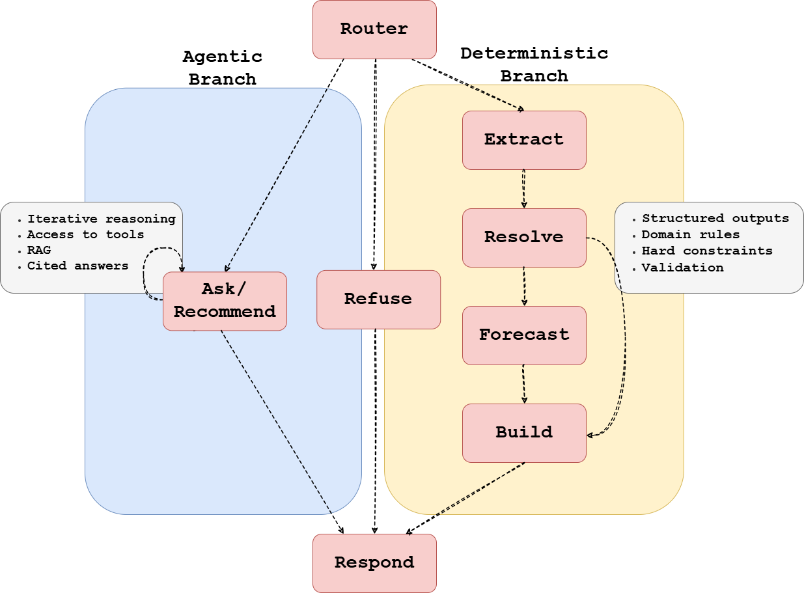
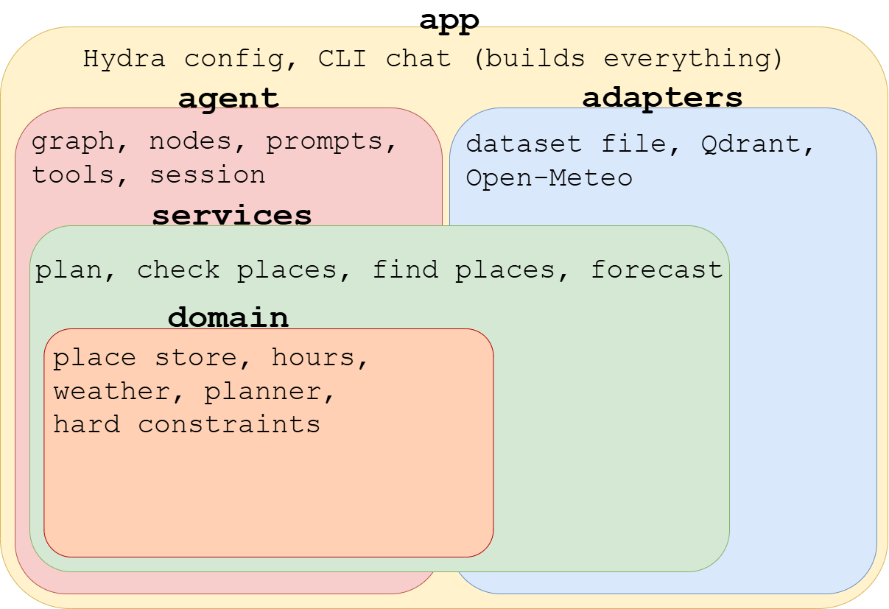

# CorGA: Corfu Guide Agent

A conversational travel assistant for Corfu, built with LangGraph. It answers questions about the island's places,
recommends places for the visitor's interests, builds a realistic half-day walking plan, and revises that plan when the
visitor changes their mind or the weather changes. The LLM reads the requests and words the replies; code checks every
date, walk, opening hour and plan.

## Demo

A plan for an outdoor history walk, then a weather check against a forecast with rain from 15:00, then a question
about the revised plan. The four stops before the rain keep their times, and the outdoor stop in the rain is replaced
by an indoor museum.

```bash
docker compose run --rm app weather=fixture hydra=debug
```

```text
Loading the dataset and the embedding model...
Model: anthropic claude-sonnet-5-5 · weather: fixture (synthetic rain, corfu_synthetic_rain.json)
▶ session db755f3b → not traced (hydra=debug)   (/help for commands)
🙋 Plan a four-hour itinerary in Corfu focused on outdoor historical attractions on Wednesday, October 7, 2026, from 13:00 to 17:00.
────────────────────────────────────────────────────────────────────────────────────────────────────────────────────────
🤖 Here is a walking plan for the afternoon of 7 October 2026, from 13:00 to 17:00. It links five stops in Corfu Town:
   the Jewish Holocaust Memorial, the Gate of the Old Fortress, the Liston Arcades, the Ionian Academy (Grimani
   Barracks) and the Gate of the New Fortress. All five are outdoor stops, and the plan passed validation with no
   violations. Walking times are rough estimates rather than routed paths, and the opening hours and visit durations are
   sample data, not live visitor information.

   Itinerary: Wednesday 07 October 2026, 13:00–17:00


    #  Stop                                        Walk    Arrive  Visit        Setting
    ───────────────────────────────────────────────────────────────────────────────────
    1  Jewish Holocaust Memorial (CF-030)          –       13:00   13:00–13:20  outdoor
    2  Gate of the Old Fortress (CF-027)           12 min  13:32   13:32–13:47  outdoor
    3  Liston Arcades (CF-032)                     3 min   13:50   13:50–14:15  outdoor
    4  Ionian Academy (Grimani Barracks) (CF-028)  6 min   14:21   14:21–14:41  outdoor
    5  Gate of the New Fortress (CF-008)           13 min  14:54   14:54–15:09  outdoor


   Assumptions:

    • Walking times are estimates: straight-line distance x 1.3 at 4.5 km/h, not a routed path.
    • All stops are visited on foot.
    • Opening hours and visit durations are sample data, not live visitor information.

   Sources (dataset records): CF-030 Jewish Holocaust Memorial; CF-027 Gate of the Old Fortress; CF-032 Liston Arcades;
   CF-028 Ionian Academy (Grimani Barracks); CF-008 Gate of the New Fortress
────────────────────────────────────────────────────────────────────────────────────────────────────────────────────────
🙋 Can you check the weather for Wednesday, October 7, 2026, afternoon and adapt my existing itinerary if needed while keeping the original 13:00 - 17:00 time window?
────────────────────────────────────────────────────────────────────────────────────────────────────────────────────────
🤖 Rain is forecast from 15:00 to 17:00 on 7 October (the forecast is a synthetic fixture, not a live one), so I
   adjusted your afternoon plan. The outdoor Gate of the New Fortress was removed because of the rain, and the indoor
   Casa Parlante Museum was added in its place, so the last stop falls in the wet window. The earlier stops are outdoors
   and come before the rain begins. Opening hours are not confirmed, since the data here are sample data rather than
   live visitor information.

   Itinerary: Wednesday 07 October 2026, 13:00–17:00


    #  Stop                                        Walk    Arrive  Visit        Setting
    ───────────────────────────────────────────────────────────────────────────────────
    1  Jewish Holocaust Memorial (CF-030)          –       13:00   13:00–13:20  outdoor
    2  Gate of the Old Fortress (CF-027)           12 min  13:32   13:32–13:47  outdoor
    3  Liston Arcades (CF-032)                     3 min   13:50   13:50–14:15  outdoor
    4  Ionian Academy (Grimani Barracks) (CF-028)  6 min   14:21   14:21–14:41  outdoor
    5  Casa Parlante Museum (CF-007)               7 min   14:48   14:48–15:43  indoor


   Assumptions:

    • Walking times are estimates: straight-line distance x 1.3 at 4.5 km/h, not a routed path.
    • All stops are visited on foot.
    • Opening hours and visit durations are sample data, not live visitor information.

   Forecast (fixture (synthetic rain, corfu_synthetic_rain.json))


    Hour       Rain (mm)  Conditions     °C
    ─────────────────────────────────────────
    Wed 13:00  0.0        mainly clear   23.0
    Wed 14:00  0.0        partly cloudy  23.0
    Wed 15:00  3.2        moderate rain  21.0
    Wed 16:00  4.1        moderate rain  20.0


   Sources (dataset records): CF-030 Jewish Holocaust Memorial; CF-027 Gate of the Old Fortress; CF-032 Liston Arcades;
   CF-028 Ionian Academy (Grimani Barracks); CF-007 Casa Parlante Museum
────────────────────────────────────────────────────────────────────────────────────────────────────────────────────────
🙋 Will it rain during the last stop?
────────────────────────────────────────────────────────────────────────────────────────────────────────────────────────
🤖 Yes, rain is likely during part of the last stop. The Casa Parlante Museum visit runs 14:48–15:43 [stop:5]. The
   forecast shows no rain at 14:00 (partly cloudy). It shows 3.2 mm of moderate rain at 15:00
   [forecast:fixture:2026-10-07T14:48/PT55M].

   So the first few minutes of the visit should be dry, and the rain starts around 15:00. The museum is indoors, so you
   should stay dry during the rainy part. You may get wet on the walk there, if the rain has started by then.
────────────────────────────────────────────────────────────────────────────────────────────────────────────────────────
🙋 /exit
✔ closed session db755f3b
```

## What it does

- **Answers questions** about the places from their records, citing each record it uses by its id.
- **Recommends places** by filtering the records on the visitor's interests, a child, museums and the setting, and
  ordering the matches by similarity.
- **Builds a plan** for a time window that fits the visit durations, the walks between stops and the opening hours, or
  explains why a request does not fit and offers the closest plan that does.
- **Revises the plan** for a follow-up, keeping the stops that still fit at their times and the stated preferences.
- **Checks the weather**, live from Open-Meteo or from a rain fixture, and replaces the outdoor stops that fall in the
  rain with indoor ones.
- **Refuses** a request to ignore the dataset or invent a place, and a request outside travel in Corfu.

## How it works

Every message runs once through a LangGraph graph ([graph.py](corga/agent/runtime/graph.py)), a
[custom router workflow](https://docs.langchain.com/oss/python/langchain/multi-agent/custom-workflow) that mixes
deterministic logic with agentic behaviour. Plan requests take a deterministic path, questions go to one agent, and each
path ends in one result that becomes the reply.

- Code checks the hard constraints, and the model only reads requests and words replies.
- Follow-ups change only what was asked. Replacing stop 2 keeps the other stops at their times, and rain replaces only
  the stops it overlaps.
- Refusals are cheap. An attack costs one route call and a fixed reply, with the plan untouched.

<p align="center"></p>

**route** makes one structured LLM call that picks the path of the latest message.

```
Route
  path: "plan" | "ask" | "attack" | "out_of_scope"
```

**extract** makes the plan path's only LLM call. It reads the recent messages and the current plan, and fills the plan
form ([request.py](corga/agent/request.py)) with only what the latest message states.

```
PlanRequest
  date:             a day, or null
  start_time:       a time, or null
  end_time:         a time, or null
  interests:        [history | venetian | museums | art | nature | food | architecture]
  child:            "yes" | "no" | "not_stated"
  avoid_museums:    "yes" | "no" | "not_stated"
  setting:          "indoor" | "outdoor" | "any" | "not_stated"
  places:           [names of specific places]
  replace_stops:    [stop numbers, 1 being the first]
  keep_other_stops: "yes" | "no" | "not_stated"
  sources:          ["forecast"]
```

- **resolve**, **forecast** and **build** are code. resolve folds the form into the stored state, forecast fetches the
  forecast when the form's sources ask for it, and build rebuilds and validates the plan.
- **ask** runs a `create_agent` loop over three tools ([ask_agent.py](corga/agent/ask_agent.py)), with middleware for
  its prompt, for tool errors and for a limit on model calls.
- **refuse** returns a fixed text with no LLM call. **respond** renders the result from a template and adds two to five
  framing sentences.

The LLM picks the path, fills the plan form, chooses the agent's tools and writes the prose. Code resolves dates and
times, merges preferences, schedules visits, computes walks, checks opening hours, detects rain and validates the plan.
Every field of the form has an explicit "not stated" value and the interests come from a closed list, so leaving a field
alone is a real answer and anything not stated keeps its stored value. "Until 16:00" only moves the end of the window.
The schemas are sent as JSON schema, native structured output on every provider. An unreadable message, a failed
forecast or an agent that runs out of calls each ends in a reply from code ([errors.py](corga/agent/nodes/errors.py)).

### Retrieval

At startup each place becomes one document with its name, category, tags, area and description, embedded with MiniLM
into a Qdrant collection kept in memory, on disk or on a server ([index.py](corga/adapters/retrieval/index.py)).

- **search**, the RAG part, embeds the question and gets ids and scores from the index. The ids are looked up in the
  place store, which holds the full records, and each record is printed with its id in brackets for the answer to cite.
  The index decides which places are relevant, and every fact comes from the dataset.
- **find_places**, the structured retrieval, filters the records on their metadata (interests, a child, museums, the
  setting), keeps the ones open that day and uses similarity only to order them
  ([places.py](corga/services/places.py)). The planner picks its candidates the same way.

The agent's prompt lists what the dataset does not hold (tickets, bookings, live opening status), so the agent says so
instead of guessing.

### Weather

The forecast comes from Open-Meteo or from the rain fixture, through one weather service shared by the plan path and the
agent's `forecast` tool ([services/weather.py](corga/services/weather.py)). Wet hours merge into rain periods. A stop is
exposed when it is outdoor or mixed and overlaps one, and rain refills the freed time with indoor places only. The agent
asks for "stop 2" or "the next 24 hours" and code turns that into hours, so the model never computes a time. Errors the
agent can act on come back to it as messages, and any other error stops the turn.

### Itinerary validation

Plain Python in the domain layer, testable without an LLM ([corga/domain/planning/](corga/domain/planning/)).

- **Candidates** are filtered on the dataset's metadata, then ordered by similarity to the interests.
- **The builder** is greedy. It picks the cheapest next stop that fits, weighing its rank against the walk.
- **The checks** are one set of clauses used by both the builder and the validator
  ([guards.py](corga/domain/planning/guards.py)). A stop sits inside the window, gets its full duration and is open for
  the whole visit. A walk is not too long. Unknown hours are never scheduled, since unknown is not open.
- **Named places** are tried in every order, up to six. If none fits, the reply gives the reasons and the best plan from
  the named places open that day.
- **Edits keep what still works** ([refill.py](corga/domain/planning/refill.py)). A stored stop is dropped only for a
  reason (replaced, another day, released by the user, no longer matching the preferences, in the rain, outside the
  window). The rest stay at their times and the gaps are refilled.

Only a plan that passes validation replaces the stored one, and failed checks are listed in the reply. Every time, walk
and check in a reply is rendered from the result by a template, and the LLM only writes the framing.

### Conversation state

- **Per conversation** (checkpointed) holds the messages, the window, the preferences and the plan.
- **Per turn** holds the path, the plan form, the forecast, the result and the reply.

The stored values change only on the plan path, from resolved values ([state.py](corga/agent/state.py)). A refused
message is removed from the history, so an attack never reaches later turns. Named places are a one-turn check, not a
preference.

### Layers

<p align="center"></p>

## Extending

- **A question source** is a tool over a service, printing ids to cite. It reaches the agent with no change to the graph
  ([tools.py](corga/agent/tools.py)).
- **A planning source** is a node between `resolve` and `build`, a value in the form's sources, and a removal reason.
- **A planning rule** is one check clause, so the builder and the validator agree on it.
- **A provider, model, dataset or weather source** is a config file or an override, no code.

## Setup

```bash
cp .env.example .env
```

| Variable | Used for |
|---|---|
| `ANTHROPIC_API_KEY`, `OPENAI_API_KEY` | the `anthropic` (default) and `openai` providers |
| `OAI_API_BASE_URL`, `OAI_API_KEY` | the `oai-api` provider, any OpenAI-compatible server |
| `QDRANT_URL`, `QDRANT_API_KEY` | a Qdrant server instead of the local index |

The place index is kept:

- on a Qdrant server when `QDRANT_URL` is set (Qdrant Cloud or your own cluster),
- else on disk in `.cache/embeddings`, reused between runs,
- else in memory with `retrieval.qdrant_path=null`, rebuilt on each start.

## Run with Docker

```bash
docker compose build
docker compose run --rm app
```

Options go after `app`, e.g. `docker compose run --rm app provider=openai weather=fixture` (see
[Configuration](#configuration)).
Or `uv run poe docker`, which also builds the image and sets your user and group ids.

## Install locally

With [uv](https://docs.astral.sh/uv/) (recommended):

```bash
uv sync
uv run poe chat
```

With pip (Python 3.12+):

```bash
pip install --extra-index-url https://download.pytorch.org/whl/cpu -e .
python -m corga
```

## Configuration

Configuration and logging are made through [Hydra](https://hydra.cc) inside [`conf/chat.yaml`](conf/chat.yaml).

| Group | Options |
|---|---|
| `provider` | `anthropic` (default), `openai`, `oai-api` |
| `weather` | `live` (default, Open-Meteo), `fixture` (synthetic rain) |
| `embedding` | `minilm` |
| `store` | `poi` |
| `retrieval` | `qdrant` |

Automated tasks run with [poe](https://poethepoet.natn.io), defined in [`tasks.toml`](tasks.toml) (run with
`uv run poe <task>`):

```text
  clean                 Remove all cache and generated files
  lint                  Run ruff linter with diff (pass directory/file as arg)
  format                Check formatting with diff (pass directory/file as arg)
  quality               Run all pre-commit hooks on all files
  test                  Run the unit test suite (pass extra pytest args after --)
  chat                  Start the interactive chat (Hydra overrides go after it)
  docker                Start the chat in Docker as your own user, building the image when needed
```

Choose the provider, and optionally its model:

```bash
uv run poe chat                                             # Anthropic (default model claude-sonnet-5-5)
uv run poe chat +model=claude-opus-5-5                      # Anthropic, another model
uv run poe chat provider=openai                             # OpenAI (default model gpt-5.4-mini)
uv run poe chat provider=openai +model=gpt-5.5              # OpenAI, another model
uv run poe chat provider=oai-api +model=Qwen/Qwen3.8-27B    # an OpenAI-compatible server, see OAI_API_BASE_URL
```

Choose the weather:

```bash
uv run poe chat                                             # the live Open-Meteo forecast (default)
uv run poe chat weather=fixture                             # the synthetic rain forecast
```

Other options:

```bash
uv run poe chat +max_stops=4 +speed_kmh=4                   # planning rules, see conf/rules.yaml
uv run poe chat retrieval.qdrant_path=null                  # keep the place index in memory
uv run poe chat hydra=debug                                 # disable logging, files and storage
```

The same options work with `uv run poe docker` and `docker compose run --rm app`.

Each run writes `runs/<provider>/<model>/<time>/`: the session traces (`sessions/<id>.json`), the log (at DEBUG) and the
resolved configuration (`.hydra/`).

## Tests

```bash
uv run poe test
```

The tests run the graph and the planner with a scripted LLM, the rain fixture and a fixed clock, so they need no API
key and no network.

The notebooks explore the places ([1.1-ck-poi-exploration.ipynb](notebooks/1.1-ck-poi-exploration.ipynb)) and the
walking times between them ([1.1-ck-walking-times.ipynb](notebooks/1.1-ck-walking-times.ipynb)).

## Assumptions and limitations

- The 50 places of the dataset are the only places. Their opening hours and visit durations are sample data, not live
  visitor information, and unknown hours count as closed.
- All times are Europe/Athens local time ([timeutil.py](corga/domain/timeutil.py)).
- All stops are visited on foot. A walk is the straight-line (haversine) distance times a detour factor of 1.3, at
  4.5 km/h, rounded up to whole minutes ([geo.py](corga/domain/planning/geo.py)), not a routed path. Both values are set
  from the command line, e.g. `+speed_kmh=4 +detour_factor=1.5`. Places outside Corfu Town are too far for a walking
  plan.
- A plan holds at most five stops, and a single walk at most 40 minutes ([rules.yaml](conf/rules.yaml)).
- An hour is wet from 0.1 mm of rain, or with a WMO rain code ([weather.py](corga/domain/weather.py)). One weather
  source serves a whole run, either the live Open-Meteo forecast or the rain fixture.
- The model can still fill in a value nobody gave. Code asks for a missing date, but cannot tell a date the model filled
  in from one the visitor stated.
- A question about a place already in the plan is sometimes answered from the conversation, without a new tool call.
