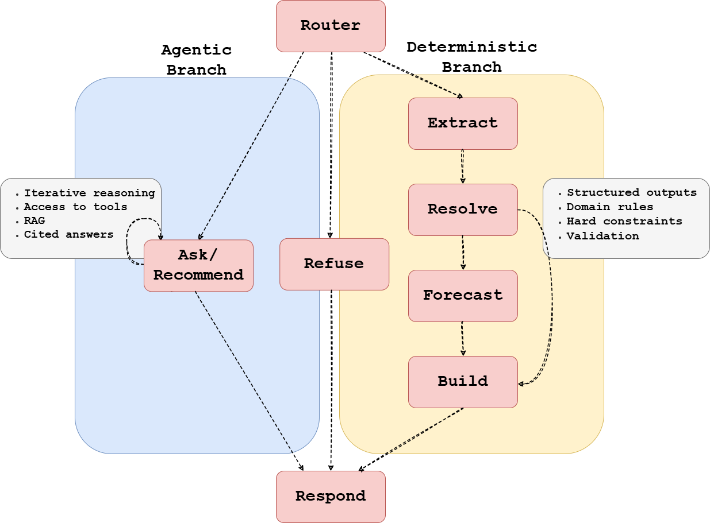
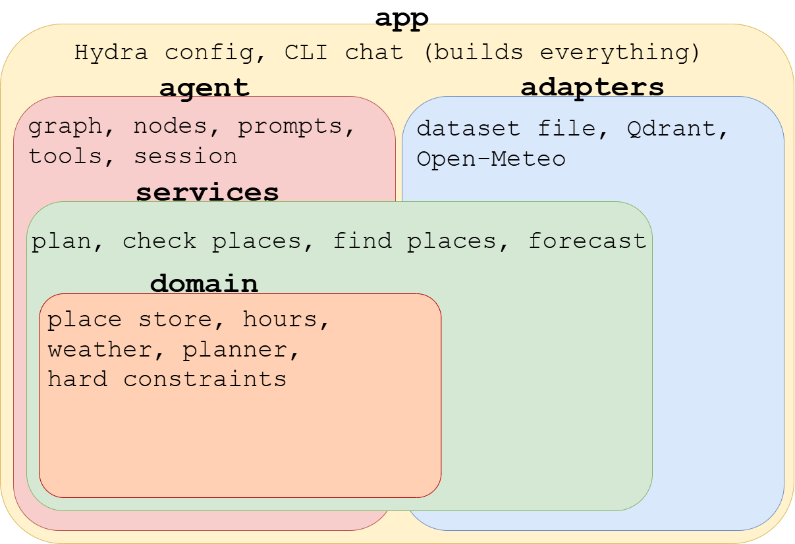

# Design note

Throughout, the following assumptions hold.

- The 50 places of the dataset are the only places. Their opening hours and visit durations are sample data,
  not live visitor information, and unknown hours mean closed.
- All times are Europe/Athens local time ([timeutil.py](../corga/domain/timeutil.py)).
- All stops are visited on foot. A walk is the straight-line distance times a detour factor of 1.3, at 4.5 km/h
  ([rules.yaml](../conf/rules.yaml)), both set from the command line, e.g. `+speed_kmh=4 +detour_factor=1.5`.
  - The straight-line distance is the haversine distance between the two coordinates, on a sphere of mean Earth
    radius, and the walk is rounded up to whole minutes ([geo.py](../corga/domain/planning/geo.py)).
- An hour is wet from 0.1 mm of rain, or with a WMO rain code ([weather.py](../corga/domain/weather.py)).
- One weather source serves a whole run, either the live Open-Meteo forecast or the rain fixture.

## One turn, one graph run

Every message runs once through a LangGraph graph ([graph.py](../corga/agent/runtime/graph.py)), and each path ends in
one result that becomes the reply. Plan requests take a deterministic path, questions an agentic one.

<p align="center"></p>

**route** makes one structured LLM call that picks the path of the latest message.

```
Route
  path: "plan" | "ask" | "attack" | "out_of_scope"
```

**extract** makes the plan path's only LLM call. It reads the recent messages and the current plan, and fills the
plan form ([request.py](../corga/agent/request.py)) with only what the latest message states.

```
PlanRequest
  date:             a day, or null
  start_time:       a time, or null
  end_time:         a time, or null
  interests:        [history | venetian | museums | art | nature | food | architecture]
  child:            "yes" | "no" | "not_stated"
  avoid_museums:    "yes" | "no" | "not_stated"
  setting:          "indoor" | "outdoor" | "any" | "not_stated"
  places:           [names of specific places]
  replace_stops:    [stop numbers, 1 being the first]
  keep_other_stops: "yes" | "no" | "not_stated"
  sources:          ["forecast"]
```

- **resolve**, **forecast** and **build** are code. resolve folds the form into the stored state, forecast fetches
  the forecast when the form's sources ask for it, and build rebuilds and validates the plan.
- **ask** runs a `create_agent` loop over three tools ([ask_agent.py](../corga/agent/ask_agent.py)), with middleware
  for its prompt, for tool errors and for a limit on model calls.
- **refuse** returns a fixed text with no LLM call. **respond** renders the result from a template and adds two to
  five framing sentences.

The LLM picks the path, fills the plan form, chooses the agent's tools and writes the prose. Code resolves dates and
times, merges preferences, schedules visits, computes walks, checks opening hours, detects rain and validates the plan.
Every field of the form has an explicit "not stated" value and the interests come from a closed list, so leaving a
field alone is a real answer and anything not stated keeps its stored value. "Until 16:00" only moves the end of the
window. The schemas are sent as JSON schema, native structured output on every provider. An unreadable message, a
failed forecast or an agent that runs out of calls each ends in a reply from code
([errors.py](../corga/agent/nodes/errors.py)).

## RAG and structured retrieval

At startup each place becomes one document with its name, category, tags, area and description, embedded with MiniLM
into a Qdrant collection kept in memory, on disk or on a server ([index.py](../corga/adapters/retrieval/index.py)).

- **search**, the RAG part, embeds the question and gets ids and scores from the index. The ids are looked up in the
  place store, which holds the full records, and each record is printed with its id in brackets for the answer to
  cite. The index decides which places are relevant, and every fact comes from the dataset.
- **find_places**, the structured retrieval, filters the records on their metadata (interests, a child, museums, the
  setting), keeps the ones open that day and uses similarity only to order them
  ([places.py](../corga/services/places.py)). The planner picks its candidates the same way.

The agent's prompt lists what the dataset does not hold (tickets, bookings, live opening status), so the agent says
so instead of guessing.

## Live tools

The forecast comes from Open-Meteo or from the rain fixture, through one weather service shared by the plan path and
the agent's `forecast` tool ([services/weather.py](../corga/services/weather.py)). Wet hours merge into rain periods.
A stop is exposed when it is outdoor or mixed and overlaps one, and rain refills the freed time with indoor places
only. The agent asks for "stop 2" or "the next 24 hours" and code turns that into hours, so the model never computes
a time. Errors the agent can act on come back to it as messages, and any other error stops the turn.

## Itinerary validation

Plain Python in the domain layer, testable without an LLM ([corga/domain/planning/](../corga/domain/planning/)).

- **Candidates** are filtered on the dataset's metadata, then ordered by similarity to the interests.
- **The builder** is greedy. It picks the cheapest next stop that fits, weighing its rank against the walk.
- **The checks** are one set of clauses used by both the builder and the validator
  ([guards.py](../corga/domain/planning/guards.py)). A stop sits inside the window, gets its full duration and is
  open for the whole visit. A walk is not too long. Unknown hours are never scheduled, since unknown is not open.
- **Named places** are tried in every order, up to six. If none fits, the reply gives the reasons and the best plan
  from the named places open that day.
- **Edits keep what still works** ([refill.py](../corga/domain/planning/refill.py)). A stored stop is dropped only for
  a reason (replaced, another day, released by the user, no longer matching the preferences, in the rain, outside the
  window). The rest stay at their times and the gaps are refilled.

Only a plan that passes validation replaces the stored one, and failed checks are listed in the reply. Every time,
walk and check in a reply is rendered from the result by a template, and the LLM only writes the framing.

## Conversation state

- **Per conversation** (checkpointed) holds the messages, the window, the preferences and the plan.
- **Per turn** holds the path, the plan form, the forecast, the result and the reply.

The stored values change only on the plan path, from resolved values ([state.py](../corga/agent/state.py)). A refused
message is removed from the history, so an attack never reaches later turns. Named places are a one-turn check, not a
preference.

## Layers

<p align="center"></p>

Each layer imports only the ones inside it. Above the agent layer the LLM interprets and phrases, below it code
decides, and the services reach the adapters through ports ([ports.py](../corga/services/ports.py)). Hydra builds
everything at startup ([conf/](../conf/)), and each run keeps its resolved config, a log and one JSON trace per
conversation.

## Extending safely

- **A question source** is a tool over a service, printing ids to cite. It reaches the agent with no change to the
  graph ([tools.py](../corga/agent/tools.py)).
- **A planning source** is a node between `resolve` and `build`, a value in the form's sources, and a removal reason.
- **A planning rule** is one check clause, so the builder and the validator agree on it.
- **A provider, model, dataset or weather source** is a config file or an override, no code.
